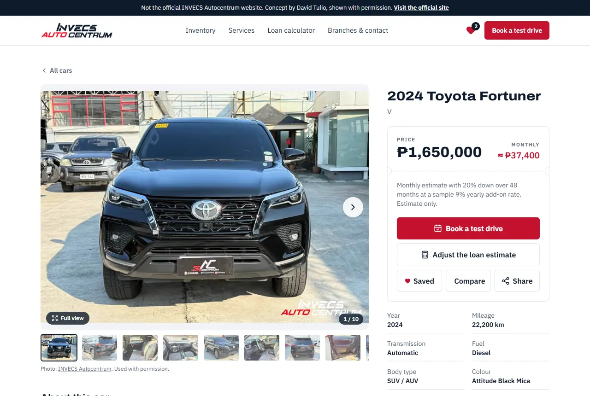
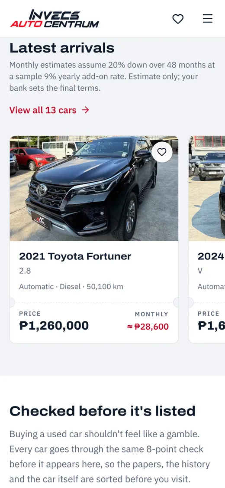
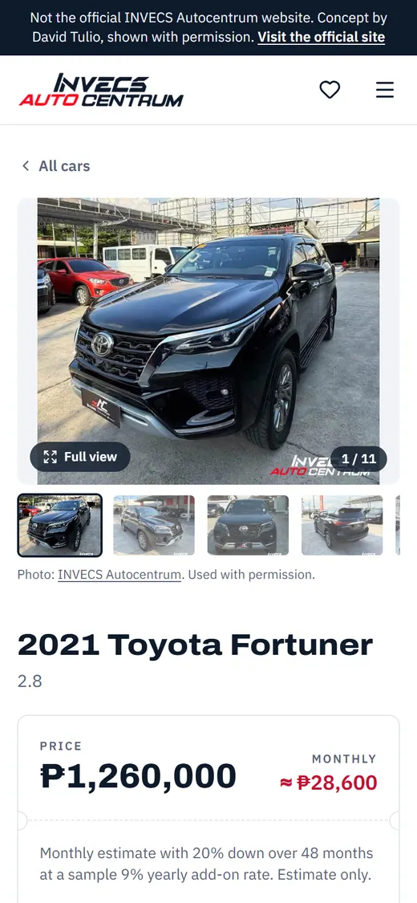
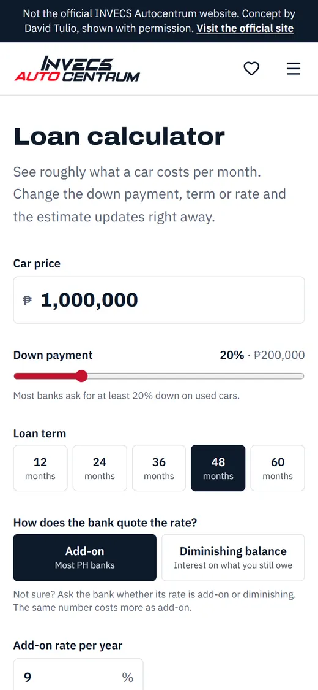
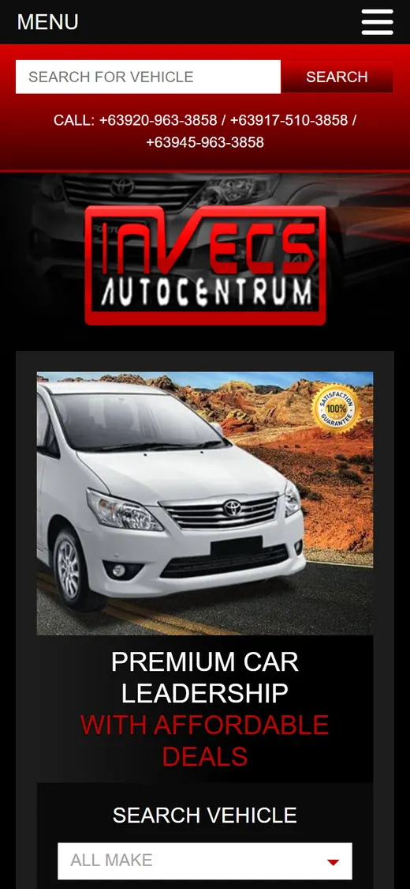
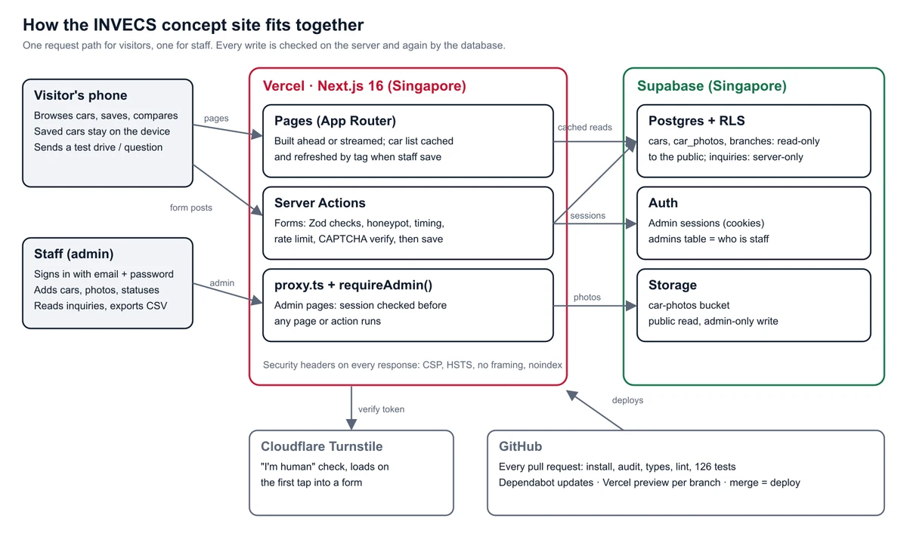

# INVECS Autocentrum: redesign concept

A full-stack, mobile-first rebuild of a Philippine used-car dealer's website: a public site where buyers browse, compare, estimate monthly payments and book test drives, and a private admin where staff manage cars and inquiries.

**Live concept:** [invecs-redesign-concept.vercel.app](https://invecs-redesign-concept.vercel.app)

> **Not the official INVECS Autocentrum website.** An unofficial concept by David Tulio, shown with the written permission of INVECS Autocentrum (October 28, 2026). It is hidden from search engines, and its forms don't reach the dealer. For the real dealer, visit [invecs.ph](https://www.invecs.ph/).



<p>
  
  
  
</p>

## My role and timeline

Built solo by **David Tulio**, BS Information Technology student at Holy Angel University, from October 16 to November 1, 2026: planning, design, front end, back end, database, security, testing and deployment. I also contacted INVECS, visited their office and got written permission to use their name, logo and car photos, so the site shows their real stock.

## Before and after

<p>
  
  
</p>

| Measure (home page, phone) | Original site | Redesign |
|---|---|---|
| Download size | 10.8 MB | **0.68 MB** (16× lighter) |
| Lighthouse performance | 43 | **84** |
| Lighthouse accessibility | 78 | **100** on every page |
| Lighthouse best practices | 57 | **100** on every page |
| Layout shift while loading (CLS) | 0.32 (poor) | **0.00** |
| Largest content visible (LCP) | 7.6 s | **4.1 s** |

Lighthouse numbers are medians of three runs on a simulated mid-range phone on slow 4G, measured on the live sites.

## What it does

**For buyers**

- Inventory with text search ("7 seater", "diesel pickup"), body-type chips, filters and sorting, in pages of 12.
- Every car shows its **full price and a monthly estimate**; the loan calculator uses the add-on rate Philippine banks quote and shows total interest and total paid.
- Photo gallery with a full-screen view, saved cars and a side-by-side compare, all without an account.
- Test-drive booking that only offers days the showroom is open (with an optional trade-in), and a question form for everything else.
- Share a car to Messenger or Viber with a proper link preview.
- A 3D body-type showroom that loads only when it's on screen.

**For staff (admin)**

- Add and edit cars, upload and reorder photos (credit and descriptions added automatically).
- Featured cars, sold status and private staff notes.
- An inquiries inbox and a CSV export that's safe to open in Excel.
- Changes go live on the site immediately.

## How it's built

**Stack:** Next.js 16 (App Router, Server Actions, cached components) · React 19 · TypeScript · Tailwind CSS 4 · Supabase (Postgres, Auth, Storage) · Zod · Cloudflare Turnstile · Vitest · Vercel · GitHub Actions



Pages are pre-built and cached, then refreshed the moment staff save a change. Only the parts that must be live (forms, the admin) run per request.

## Security highlights

- **Admin protected three times on every request:** a proxy check, a server-side admin check in every page and action, and Row Level Security in Postgres as the last line.
- **Visitors can't write to the database directly.** Only the server saves inquiries, after every check below.
- **Form defences, cheapest first:** hidden honeypot field, a signed "too fast" time stamp, a rate limit (5 per 10 minutes, IP stored only as a one-way hash), Cloudflare Turnstile, then validation in the browser, on the server and in the database.
- **Security headers:** a strict Content Security Policy, HSTS, no embedding in other sites, and camera, microphone and location off.
- **Safe scripts:** the sample-data command refuses to run on a database with real listings.
- **Privacy:** only the fields needed to reply, inquiries deleted after 30 days, no tracking cookies, and a plain-language [privacy notice](https://invecs-redesign-concept.vercel.app/privacy) written with the Data Privacy Act (RA 10173) in mind.

The full update routine and security log are in [SECURITY.md](SECURITY.md).

## Testing and quality

- **126 unit tests** (Vitest) for loan maths, form rules, filters and the car schema.
- **CI on every pull request** (GitHub Actions): type checks, lint, tests, `npm audit` and package signature checks; Dependabot for updates; exact package versions.
- **14 of 14 attack tests blocked** on the contact form: injections, forged fields, floods, failed CAPTCHAs and direct database calls.
- **0 accessibility issues** in axe scans of every page, at phone and desktop sizes.
- Every change went through a branch, a Vercel preview checked on a real phone, and green CI before merging.

## How I used AI

I built this with **Claude Code**, an AI coding assistant, as a pair programmer. I set the direction and rules, approved or rejected every plan and design, tested every preview on my phone, ran the database migrations and managed the accounts and keys. The AI proposed plans, wrote most of the code and tests, and ran the checks. It wasn't always right, so every claim was verified before merging: I treat AI output like a colleague's pull request.

## What I learned

- **Measure first.** Tuning only worked because I measured before and after each change, which also showed which fix didn't help.
- **Security is layers.** Each defence assumes the one before it failed.
- **Mobile first means real phones.** Several problems only showed up when using the site like a buyer.
- **Talk to the client.** Asking for permission turned a mock-up into a site with real stock and a real stakeholder.

## Run it locally

1. Create a Supabase project. Turn **off** "Automatically expose new tables"; the migrations grant access table by table.
2. In Supabase → SQL Editor, run each file in [`supabase/migrations/`](supabase/migrations/) once, in number order (`0003` is optional).
3. Create a Cloudflare Turnstile widget (hostname `localhost` for development).
4. Copy `.env.example` to `.env.local` and fill in the Supabase URL, publishable key and secret key (Project Settings → API Keys) and the Turnstile site and secret keys.
5. Create the admin account: in Supabase → Authentication, turn **off** "Allow new users to sign up", add a user (email + password, auto-confirm), then run:
   ```sql
   insert into public.admins (user_id) select id from auth.users where email = 'you@example.com';
   ```
6. Then:

```bash
npm install
npm run db:seed   # loads the sample cars into an empty database (refuses if real cars exist)
npm run dev       # http://localhost:3000
npm test          # unit tests
```

`npm run build`, `npm run lint` and `npm test` must pass before every commit. Test the admin on a production build (`npm run build && npm run start`).

## Credits and permission

INVECS Autocentrum gave written permission (October 28, 2026) to use its **name and brand, logo, and car photos from its website and social media pages** in this personal project and portfolio. Listing photos on the live site: **INVECS Autocentrum**, used with permission. Prices and availability may be out of date, so buyers are asked to confirm with INVECS.

3D cars in the body-type showroom: the SUV, pickup, sedan, hatchback and minivan from ["Generic passenger car pack"](https://sketchfab.com/3d-models/20f9af9b8a404d5cb022ac6fe87f21f5) by comrade1280, licensed under [CC BY 4.0](https://creativecommons.org/licenses/by/4.0/). Changes: taken out of the pack, textures removed and recoloured grey, turned to face forward, a turntable disc added, and compressed (`public/models/`). The still pictures in `src/assets/showroom/` are renders of the same models.

Home page header photo: [Ivan Kazlouskij](https://unsplash.com/photos/euFJPwObDWI) (dealer lot), [Unsplash License](https://unsplash.com/license).

<details>
<summary>Sample-data photos (development seed only)</summary>

[`scripts/seed-data.ts`](scripts/seed-data.ts) holds sample cars for local development. Their photos are from [Unsplash](https://unsplash.com), used under the [Unsplash License](https://unsplash.com/license). Each was checked to show the same model as its sample listing, but it is not the actual car for sale.

| Car | Photographer |
|---|---|
| 2023 Ford Everest Titanium+ 2.0 Bi-Turbo 4x4 | [Duc Van](https://unsplash.com/photos/gCE639_EJXk) |
| 2022 Toyota Innova 2.8 E Diesel | [Zoshua Colah](https://unsplash.com/photos/1gpG9X34UWI) |
| 2022 Toyota Innova 2.8 E Diesel | [Zoshua Colah](https://unsplash.com/photos/i7iC4G_FjQA) |
| 2021 Toyota Hilux Conquest 2.8 4x4 | [Shrawan Choudhary](https://unsplash.com/photos/c2kxNwDcPZo) |
| 2021 Toyota Fortuner 2.8 V 4x4 | [Devan Mnn](https://unsplash.com/photos/9Px9UR-wZkQ) |
| 2019 Mazda CX-5 2.0 FWD Pro | [Ryan Collins](https://unsplash.com/photos/969FKoxL-KU) |
| 2019 Mazda CX-5 2.0 FWD Pro | [Ryan Collins](https://unsplash.com/photos/8mY0pDJfzPw) |
| 2021 Ford Ranger Raptor 2.0 Bi-Turbo | [Paolo Resteghini](https://unsplash.com/photos/z8Jq1vrv9NI) |
| 2020 Ford Ranger Wildtrak 2.0 4x2 | [Cassiano K. Wehr](https://unsplash.com/photos/zLl2Rw686Lc) |
| 2019 Ford Everest Titanium 2.0 4x2 | [Nidhil Amen](https://unsplash.com/photos/fiEUp1hFzgI) |
| 2017 Toyota Hilux G 2.4 4x2 | [Cassiano K. Wehr](https://unsplash.com/photos/tvi8dUU3ULk) |
| 2016 BMW 3 Series 318d Sport | [Александр Бендус](https://unsplash.com/photos/e5-IZROAAx0) |
| 2017 Jeep Wrangler Unlimited Sahara | [Talia](https://unsplash.com/photos/sBPnD3jzQ7g) |
| 2018 Honda Civic 1.5 RS Turbo | [Harrison Fitts](https://unsplash.com/photos/zE2VGbJSYns) |
| 2016 Nissan Patrol Royale 5.6 V8 4x4 | [Jimith Varghese](https://unsplash.com/photos/5xWWiUzVosU) |
| 2015 Mitsubishi Pajero BK 3.2 4x4 | [Abuli Munavary](https://unsplash.com/photos/6oFXfp6diMM) |
| 2018 Ford F-150 XLT 3.5 EcoBoost | [David French](https://unsplash.com/photos/v-nQKGEWIKg) |
| 2012 Nissan Patrol Super Safari 3.0 4x4 | [Petko Boiadjiev](https://unsplash.com/photos/Gjhd1ou3VhU) |
| 2012 Nissan Patrol Super Safari 3.0 4x4 | [Petko Boiadjiev](https://unsplash.com/photos/Gp37cJRJYCI) |
| 2017 Toyota Vios 1.3 E | [lens zone](https://unsplash.com/photos/OeetzjQR1Z0) |
| 2017 Toyota Vios 1.3 E | [lens zone](https://unsplash.com/photos/MBPnn_5celI) |
| 2008 Mitsubishi Montero Sport GLS 2.5 4x4 | [Sergio Gómez](https://unsplash.com/photos/BHGFpY_iHis) |
| 1998 Ford F-150 XLT SuperCab | [Dan Williams](https://unsplash.com/photos/dyKsaQ2JfQQ) |
| 2021 Nissan Navara VL 2.5 4x4 | [Šimom Caban](https://unsplash.com/photos/NrBc2oOaKU8) |

</details>
